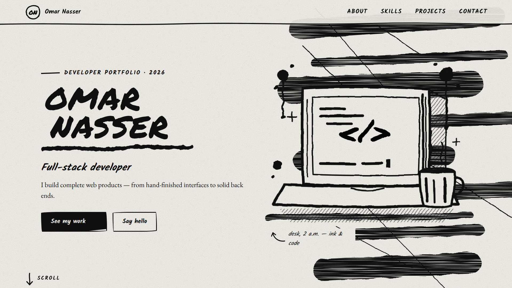
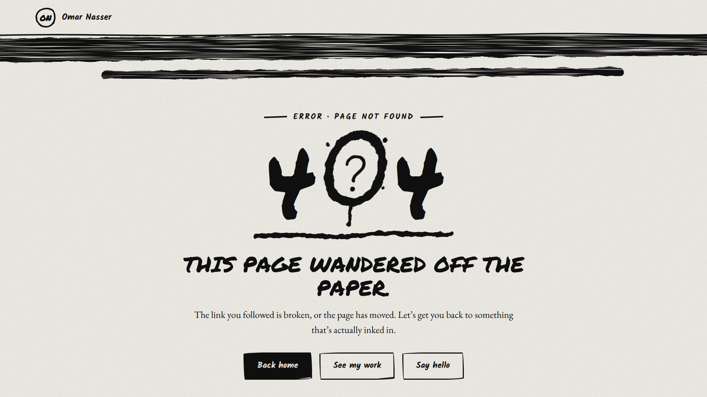

# Inkfolio — Hand-Drawn Developer Portfolio

  A creative developer portfolio built with pure HTML, CSS, and JavaScript — where hand-drawn illustrations, ink-inspired animations, and thoughtful interactions bring a personal touch to the web.

---

## ⬧ Overview

**Inkfolio** is a single-page developer portfolio designed around the idea of turning a traditional portfolio into a digital sketchbook.

Instead of relying on generic layouts and conventional UI patterns, it uses an ink-on-paper aesthetic, custom SVG illustrations, rough hand-drawn borders, and animated strokes to create a distinctive visual identity.

The entire experience is built with vanilla HTML, CSS, and JavaScript, without requiring a frontend framework or build tools.

## ⬨ Features

- **Hand-Drawn Visual Identity** — Sketch-inspired illustrations, ink textures, irregular borders, and a paper-like background.
- **Animated SVG Artwork** — Draw-on effects, animated details, and illustrations that reveal themselves as you scroll.
- **Responsive Layout** — Adaptive sections and navigation for desktop, tablet, and mobile screens.
- **Dynamic Portfolio Content** — Personal information, skills, projects, and social links.
- **About Section** — Developer introduction, personal statement, and quick facts.
- **Skills Showcase** — Technical skills presented with custom brush-stroke illustrations.
- **Project Gallery** — Project previews, technology tags, descriptions, and external links.
- **Contact Form** — Validates contact details and prepares a message in the visitor's default email application.
- **Email Copy Button** — Copies the configured email address to the clipboard.
- **Interactive Navigation** — Mobile menu, active-section indicators, smooth scrolling, and a scroll-aware header.
- **Custom 404 Error Page** — A dedicated error page displayed when a requested page cannot be found.
- **Accessibility Considerations** — Keyboard focus indicators, descriptive labels, reduced-motion support, and a skip-to-content link.
- **Lightweight Architecture** — Built without a frontend framework or compilation tools.

## ◈ Tech Stack

- HTML5
- CSS3
- Vanilla JavaScript (ES6+)
- SVG Illustrations and Animations
- Google Fonts
- Intersection Observer API
- Clipboard API
- Responsive Web Design

---

## ◉ Website Preview

  

  

---

## 🡲 Live Demo

---

## </> Developer

**Developed by [Raed Mosaed](https://github.com/raedmosaed0)**

---

© 2026 Raed Mosaed. All rights reserved.
